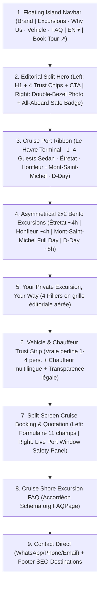

# 01 — Framer-Style Layout & Design System Specification

> **Objectif :** Passer du template VTC générique noir/or actuel (`CARINE VTC`) à une **expérience éditoriale haut de gamme type Framer / Awwwards**, pensée pour des croisiéristes internationaux (USA, UK, Allemagne, Espagne) débarquant au **Port du Havre**.

---

## 1. Positionnement Visuel & Direction Artistique

| Pilier | Décision Design | Pourquoi pour les croisiéristes |
| :--- | :--- | :--- |
| **Palette Maîtresse** | **Bleu Nuit Maritime** (`#06101E` / `#0B192C`) + **Doré Champagne Discret** (`#C8A45D`) + **Blanc Pur / Crème** (`#F8FAFC`) | Évoque immédiatement la mer, les paquebots de croisière, la côte normande et le luxe sobre (vs le noir agressif "taxi de nuit"). |
| **Archétype Layout** | **Editorial Split Hero** + **Asymmetrical Bento Grid** + **Double-Bezel Hardware Cards** | Casse la monotonie des grilles 3 colonnes classiques et donne une sensation d'agence boutique ($100k+ studio look). |
| **Typographie** | **Display Serif** (`Cormorant Garamond` ou `Instrument Serif`) pour H1/H2 + **Geometric Sans** (`Plus Jakarta Sans`) pour UI/corps | Le contraste Serif éditorial + Sans géométrique crée un positionnement "Private Concierge & Travel", bien plus rassurant qu'une typo techno/sportive. |
| **Iconographie** | Traits fins et précis (`strokeWidth={1.35}` sur Lucide ou Phosphor Light) | Légèreté et élégance visuelle. |

### Wireframe Visuel — Framer Layout (Desktop & Mobile)

```text
+-----------------------------------------------------------------------------------+
|  [ NORMANDY SHORE PRIVATE ]      Excursions · Why Us · Vehicle · FAQ    [EN v] (WA) [Book Tour ↗] |
+-----------------------------------------------------------------------------------+
|                                                                                   |
|  [● LE HAVRE CRUISE PORT · 1–4 GUESTS]          +-------------------------------+ |
|                                                 |  +-------------------------+  | |
|  Discover Normandy,                             |  | [Photo Étretat / Sedan] |  | |
|  Your Way.                                      |  |                         |  | |
|                                                 |  |  ★ All-Aboard Safe      |  | |
|  Private Shore Excursions from Le Havre         |  |    Back before departure|  | |
|  Cruise Port. Explore Normandy in comfort       |  +-------------------------+  | |
|  with your own private driver.                  |  [1–4 Guests · Price per Car] | |
|                                                 +-------------------------------+ |
|  ✓ Private sedan (1–4)  ✓ Pier pick-up                                            |
|  ✓ Flexible itineraries ✓ Multilingual                                            |
|                                                                                   |
|  ( BOOK YOUR PRIVATE EXCURSION  [↗] )   [ Explore Destinations ]                  |
+-----------------------------------------------------------------------------------+
|  >>> LE HAVRE TERMINAL · ÉTRETAT · HONFLEUR · MONT-SAINT-MICHEL · D-DAY BEACHES   |
+-----------------------------------------------------------------------------------+
|  EXPLORE NORMANDY — Asymmetrical Bento Grid (2x2)                                 |
|  +---------------------------------------+  +-----------------------------------+ |
|  | [Photo Falaises d'Étretat]      [~4h] |  | [Photo Port d'Honfleur]     [~4h] | |
|  | ÉTRETAT – The Famous Cliffs           |  | HONFLEUR – The Charming Harbour   | |
|  | ~35 min from pier · [Select Tour ↗]   |  | ~30 min from pier · [Select Tour ↗]| |
|  +---------------------------------------+  +-----------------------------------+ |
|  +-----------------------------------+  +---------------------------------------+ |
|  | [Photo Mont-Saint-Michel] [Full Day] |  | [Photo D-Day Beaches]        [~8h] | |
|  | MONT-SAINT-MICHEL                 |  | D-DAY LANDING BEACHES                 | |
|  | Adapted to ship · [Select Tour ↗] |  | Omaha & Cemetery · [Select Tour ↗]    | |
|  +-----------------------------------+  +---------------------------------------+ |
+-----------------------------------------------------------------------------------+
|  PLAN YOUR NORMANDY EXCURSION — Split-Screen Cruise Booking                       |
|  +---------------------------------------+  +-----------------------------------+ |
|  | 1. Cruise Schedule                    |  | LIVE PORT SCHEDULE CHECK          | |
|  | [Ship Name] [Arrival Date]            |  | Port Window: 08:00 -> 18:30 (10h30)| |
|  | [Arrival Time] [All Aboard Time *]    |  | Status: Safe Margin (+90 min)     | |
|  | 2. Excursion & Group                  |  | Vehicle: Exclusive Sedan (1-4)    | |
|  | [Excursion v] [Guests 1-4 v] [Lang v] |  |                                   | |
|  | 3. Contact & Requests                 |  | "All bookings subject to          | |
|  | [Full Name] [Email] [WhatsApp]        |  |  availability & confirmation..."  | |
|  | [Additional Requests...]              |  | ( REQUEST YOUR PRIVATE TOUR [↗] ) | |
|  +---------------------------------------+  +-----------------------------------+ |
+-----------------------------------------------------------------------------------+
```

---

## 2. Tokens Design System (`config.ts` & `app/globals.css`)

```ts
export const MARITIME_THEME = {
  modes: {
    dark: {
      bg: "#06101E",           // Bleu nuit abyssal (fond principal)
      surface: "#0B192C",      // Bleu nuit ardoise (cartes & panneaux)
      surface2: "#0F223D",     // Bleu nuit surélevé (hover & sous-sections)
      border: "rgba(200, 164, 93, 0.16)",
      borderSubtle: "rgba(248, 250, 252, 0.08)",
      text: "#F8FAFC",         // Blanc pur lisible
      muted: "#A9B8CC",        // Gris-bleu doux
    },
    light: {
      bg: "#F8FAFC",           // Blanc côtier (mode jour optionnel)
      surface: "#FFFFFF",
      surface2: "#EFF4FA",
      border: "rgba(11, 25, 44, 0.10)",
      text: "#0A1628",
      muted: "#475569",
    },
  },
  colors: {
    gold: "#C8A45D",           // Doré discret champagne
    goldHover: "#D9B873",
    goldSoft: "rgba(200, 164, 93, 0.12)",
    success: "#22C55E",        // Badge "Safe Return Margin"
    warning: "#F59E0B",        // Alerte marge serrée All-Aboard
    danger: "#EF4444",
  },
};
```

---

## 3. Architecture des Composants "Framer-Grade"

### A. Floating Island Navbar (`ui/layout/Navbar.tsx`)
- **Forme :** Pilule flottante centrée (`max-w-6xl rounded-full mt-5 px-6`), détachée du haut de l'écran, effet verre dépoli bleu nuit (`backdrop-blur-2xl bg-[#06101E]/75 border border-[#C8A45D]/20`).
- **Contenu Desktop :**
  1. **Logo / Marque** à gauche (nom + sous-titre *Le Havre Cruise Port*).
  2. **Navigation épurée (4 liens max)** : `Excursions` · `Why Us` · `Vehicle` · `FAQ`.
  3. **Zone Action à droite :**
     - Sélecteur de langue **`EN ▾`** (`EN`, `FR`, `ES`, `DE`) en pilule discrète.
     - Bouton WhatsApp icône sobre.
     - CTA principal pilule dorée : `Book Tour ↗` (scroll vers `#booking`).
- **Mobile (< 768px) :** Hamburger morphing animé en 'X' + panneau plein écran glassmorphism avec apparition décalée (*staggered reveal*) des liens + accès direct WhatsApp.

### B. Double-Bezel Card Architecture (Règle visuelle clé)
Aucune carte ne doit ressembler à un rectangle plat. Chaque carte majeure (Hero visual, 4 Excursions, Véhicule, Formulaire) utilise une **double bordure concentrique** :
- **Coque externe (Outer Shell) :** `p-1.5 rounded-[2rem] bg-white/[0.03] ring-1 ring-white/10`
- **Cœur interne (Inner Core) :** `rounded-[calc(2rem-0.375rem)] bg-[#0B192C] shadow-[inset_0_1px_1px_rgba(255,255,255,0.08)] overflow-hidden`

### C. Button-in-Button CTA Pattern
Tous les boutons d'action principaux (`BOOK YOUR PRIVATE EXCURSION`, `REQUEST YOUR PRIVATE TOUR`) utilisent le pattern Framer « pilule avec pastille icône intégrée » :
- Bouton `rounded-full pl-7 pr-2.5 py-2.5 bg-[#C8A45D] text-[#06101E] font-semibold`
- Pastille interne droite `w-9 h-9 rounded-full bg-[#06101E]/15 flex items-center justify-center transition-transform group-hover:translate-x-0.5 group-hover:-translate-y-0.5` contenant l'icône `ArrowUpRight`.

---

## 4. Blueprint Visuel de la Page d'Accueil (Section par Section)



### Détail de la différence majeure vs l'ancien layout :
1. **Hero Split-Screen asymétrique (au lieu d'un texte centré sur fond sombre)** :
   - **Colonne Gauche (55%) :** Eyebrow pill `LE HAVRE CRUISE PORT · 1–4 GUESTS`, H1 serif massif *Discover Normandy, Your Way.*, sous-titre *Private Shore Excursions from Le Havre Cruise Port*, liste compacte des 4 avantages clés, et duo de CTAs (`BOOK YOUR PRIVATE EXCURSION ↗` + `Explore Destinations`).
   - **Colonne Droite (45%) :** Cadre Double-Bezel avec visuel haute définition (berline face au terminal ou falaises d'Étretat) + **2 cartes flottantes minimalistes** :
     - En haut à droite : `All-Aboard Guarantee` (*Return timed to your ship's departure*).
     - En bas à gauche : `Exclusive Vehicle` (*1 to 4 guests · Price per car, never per seat*).
2. **Bento Grid Asymétrique pour les 4 Excursions (`ExcursionsSection`)** :
   - En desktop, alternance visuelle élégante (par exemple **ligne 1 :** Étretat `col-span-7` + Honfleur `col-span-5` ; **ligne 2 :** Mont-Saint-Michel `col-span-5` + D-Day Landing Beaches `col-span-7`) pour briser la symétrie plate.
   - Chaque carte affiche : Photo couleur riche (plus de noir & blanc terne comme `grayscale` dans l'ancien code !), badge durée indicative (`~4 Hours`, `Full Day`, `~8 Hours`), distance/temps de trajet depuis le port du Havre (info rassurante pour le croisiériste), courte description et bouton **`Select This Excursion ↗`** qui scrolle vers `#booking` et pré-remplit automatiquement le champ `Preferred excursion`.
3. **Formulaire Croisiériste Split-Screen (`BookingSection`)** :
   - **À gauche (7 cols) :** Formulaire ultra-clair en 3 mini-étapes visuelles sur un seul écran (sans rechargement) :
     - *1. Your Cruise Schedule* (`Cruise ship name`, `Date of arrival`, `Ship arrival time`, `All aboard time`)
     - *2. Your Excursion & Group* (`Preferred excursion`, `Number of guests 1–4`, `Preferred language`)
     - *3. Contact & Requests* (`Full name`, `Email address`, `WhatsApp / Phone number`, `Additional requests`)
   - **À droite (5 cols — Sticky Summary Card) :**
     - Calcule en temps réel la **fenêtre d'escale disponible** (`All aboard time - Ship arrival time`) et affiche un indicateur rassurant (*e.g. "9h30 port window — Ideal for Étretat or D-Day Beaches with safe 1h+ buffer"* ou une alerte douce si Mont-Saint-Michel est choisi sur une escale courte).
     - Affiche clairement l'encadré légal : *"Please note that all bookings are subject to availability and confirmation. We will contact you with a personalized quotation."*
     - Bouton principal **`REQUEST YOUR PRIVATE TOUR ↗`** + option rapide **`Send directly via WhatsApp`**.

---

## 5. Chorégraphie Motion & Règles Mobile

- **Courbe d'animation unique :** `ease: [0.32, 0.72, 0, 1]` (inertie fluide Apple/Framer).
- **Performances GPU :** Uniquement `transform` et `opacity`. Aucun `backdrop-blur` sur les cartes qui défilent (réservé à la Navbar fixe et aux modales).
- **Responsive Mobile (`< 768px`) :**
  - Toutes les grilles asymétriques (`col-span-7` / `col-span-5`) basculent proprement en `grid-cols-1`.
  - Remplacement de `h-screen` par `min-h-[100dvh]` pour éviter les sauts Safari iOS.
  - Bouton CTA collant optionnel en bas sur mobile (*"Plan Your Excursion ↗"*).
